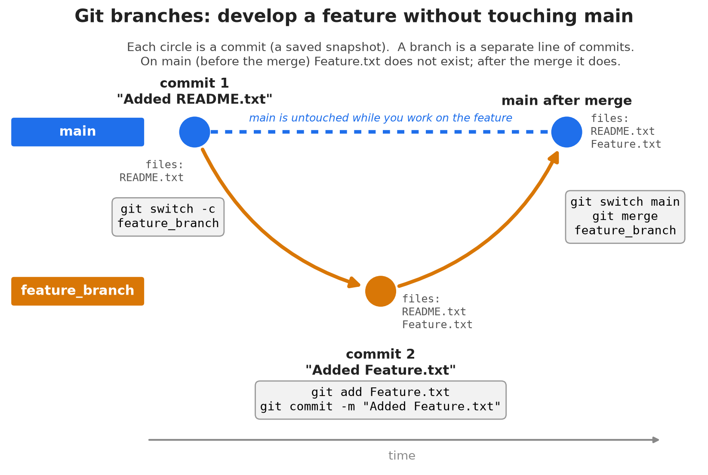
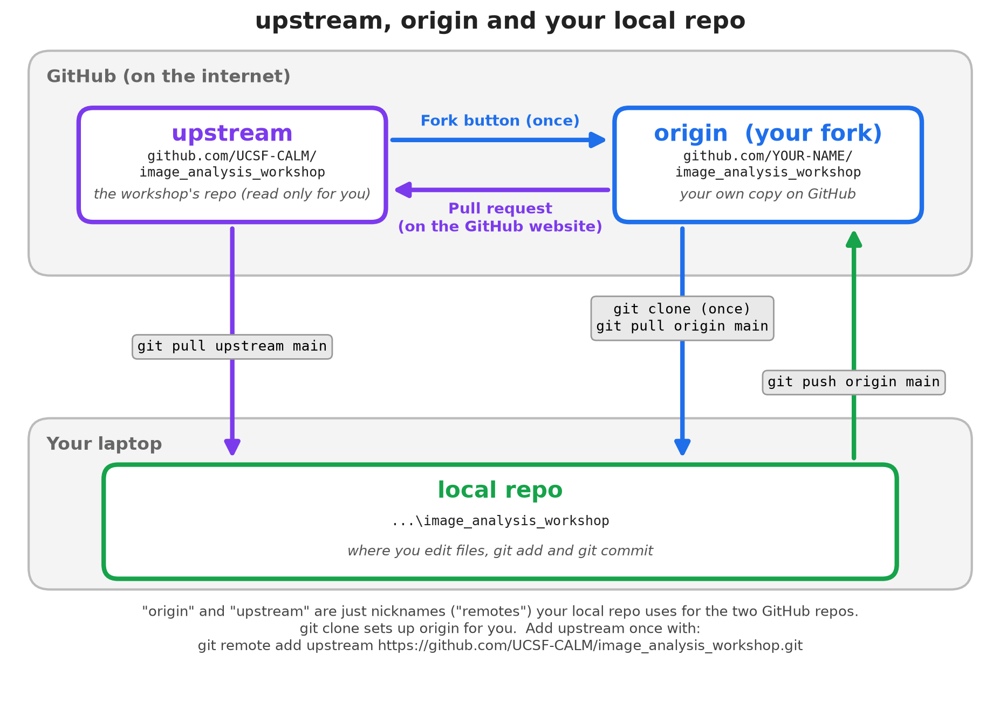
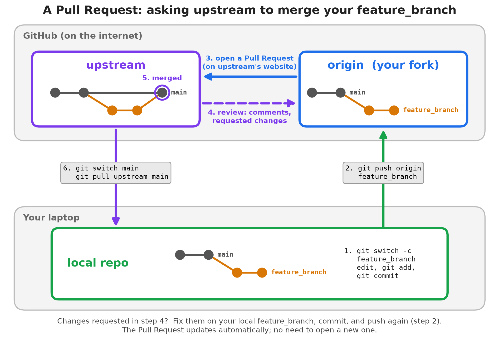

# **Git and Github, and introduction**

Start a Git repository on your own computer. Go to the place your github repo will live.  Create a directory (by default, this will become the name of the repo), cd into the directory, here "git_test", and :
```text
git init
```

This will create the .git directory that will hold information and settings about your git repository.  

Note: you can also use `uv init`.  Uv will not only create a Python project but also start a git repository.

---

# **Adding files and committing files**

Add a text file to your new repo, let's say "README.txt".

```text
git status
```

You will see:
```text
On branch main
No commits yet
Untracked files:
  (use "git add <file>..." to include in what will be committed)
        README.txt
nothing added to commit but untracked files present (use "git add" to track)
```

---
# **Adding files and committing files (2)**

Add the file:
```text
git add README.txt
```

`git status` now will show:
```text
On branch main
No commits yet
Changes to be committed:
  (use "git rm --cached <file>..." to unstage)
        new file:   README.txt
```

Your README.txt is "staged", but is not committed yet.

---

# **Adding files and committing files (3)**

Now you can commit:

```text
git commit -m "Added a README.txt file to explain the contents of this repo."
```

The part after the `-m` flag is your comment that will be stored with this commit.

---

# **Useful info about your repo**

`git diff` will show you the differences between committed files and files you currently have (unstaged).  

`git status` will show you new files and staged files.  Sometimes, you do not want to add files to a git repository.  Adding those files to `.gitignore` (and checking `.gitignore` into git) will cause git to ignore the listed files.  Wildcards are allowed.

`git log` shows the commits in order

`gitk` or `git-gui` shows a GUI with the history of your repo

---

# **Checking the history of your repo**

`git log` Will return something like:


```text
commit eeccdbd3b45359ded92b12686bf574baeb36b5bd (HEAD -> main)
Author: Nico Stuurman <nico.stuurman@ucsf.edu>
Date:   Tue Oct 27 09:46:48 2026 -0700
    Added a README.txt file to explain the contents of this repo.
```

The long number after "commit" is a "hash", a number that uniquely identifies the changes you made in this commit.  

---

You can refer to the hash when you would like to specify a commit.  In fact, you only need the first unique numbers of the commit.   So, you can write (change the number to match your hash):

```text
git log eeccdbd
```

And you will be told what this commit was about.  

Or you can return to the state of a previous commit:

```text
git checkout eeccdbd
```

(return to the "normal" state with `git switch -`)

---

# **Work on a feature in a branch**

When you would like to add something new to your code, but would like the code itself to remain intact until you are ready, you create a new branch:

```text
git switch -c feature_branch
```

In this branch, create a new file, add, and commit.  Let's call the file: "Feature.txt".

Check the file system for the presence of "Feature.txt" (type `ls`).

---

Now, switch back to main (the "main" branch):

```text
git switch main
```

Check the file system again.  Is "Feature.txt" still there?

---

# **Merge your features back to main**

Let's say that you are happy with your new feature.  You can now merge that feature back to the main branch.  Make sure your are in main (`git switch main`), then:

```text
git merge feature_branch
```

Check the file system, is "Feature.txt" present?  

This is the simplest merge possible, most often changes will have happened on the main branch.  There are multiple merge strategies, and there can be merge conflicts that you will need to resolve.

---


---

# **Syncing with repos in other locations**

On GitHub, create a repo "git_test".  Make sure not to add anything.

Add the GitHub "git_test" as a remote repository to the repo on oyur laptop:

```text
git remote add origin https://github.com/nicost/git_test.git
```
(replace "nicost" with your user name). 
You are telling git that there is a "remote" repo named "origin" that you can push your changes to and pull content from into your repo.

---

Now "push" the contents of your main branch to the main branch on github:

```text
git push -u origin main
```

From now on, git knows where you want to push and you no longer need  the "-u origin". Note that you specified "origin" as the remote name for your GitHub repo, and you need to tell that you want to push to the main branch. 

To fetch back changes that may have appeared on Github:

```text
git pull 
```

---

# **Common "remotes" on GitHub**

Often (as in "image_analysis_workshop"), you will find the repo on GitHub, you "Fork" the repo on GitHub (make a copy of the repo that will live in your GitHub space and that you can read and write), and then clone your fork to your laptop.

Your clone on the laptop will know (or can be made to know) of 2 remote repositories, "origin" is your fork, and "upstream" is the original repository.


---



---

# **GitHub Pull Requests (PRs)**

Instead of merging your feature_branch into main, push it to origin on GitHub.

Then, go to the website of the upstream repo, go to the tab "Pull Requests" and find a button that let's you open a "Pull Request", asking the maintainers of the upstream repo to merge your feature_branch into their repository.

The maintainers may merge your code, ask you to modify it, or they can even modify it themselves (and push back int your feature_branch).  

Pull Requests greatly facilitate collaborating on code.

---



---

# **Tagging your repo**

To make it easy to return to a known state, you can tag your repo. Here I used the tag "as_published":

```
git tag -a as_published -m "This is the version of the code used to prepare our BioArchive preprint"
```

You will need to push the tag to an upstream:

```
git push origin as_published
```

---

You (and everyone who forked and cloned your repo) can return to the exact state corresponding to the tag:

```
git checkout as_published
```
