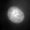
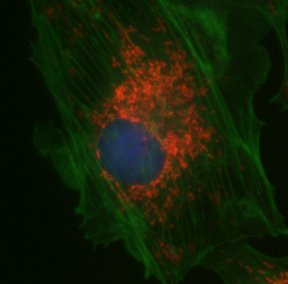
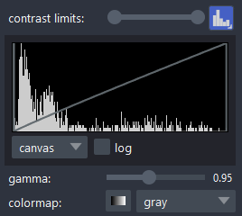

# Digital images are representations of streams of numbers

## Computer representation of images - Basics
Computers represent images as streams of numbers.  Each number correlates with one spatial element in the image.  We call these numbers "pixels" (2D images), or "voxels" (for 3D images, this latter term seems to have gone out of fashion).  The streams of numbers are generated by some kind of device, either a camera (which itself has a grid with rows and columns of photo-sensitive elements that we also call pixels), a photon sensor such as a Photo-Multiplier Tube, or (Avalanche) Photo-Diode that is read out sequentially in time resulting in a number stream, or sometimes these numbers are generated in the computer itself (i.e. "fake" images).

The numbers underlying an image can be of any type that the computer understands.  They can be integer numbers, or rational numbers (which in a computer, are called floating point numbers, where type "double" uses more storage space and has a larger range than type "float").  When the numbers are integers, they will have a certain range, again depending on how much space we give each number.  The range can be 1 bit (in which case the only possible numbers are 0 and 1), or 2 or more bits.  Computers like to assemble bits in packages of 8, which are called bytes. So, 1 byte (8-bit) images are common, and these have a range of 0-255 (note that we start counting at zero).  There are sensors that deliver 12-bit (0-4095), 16-bit (0-65,535) or even more bits.  Although these numbers can be packed (e.g. 2 12-bit numbers can fit in 3 bytes), it is often more convenient to store each number in 2 (or more) bytes, e.g. 2 12-bit numbers will be placed in 2 x 2 bytes = 4 bytes.  

Apart from the numbers themselves, there is a minimum set of metadata that needs to accompany an image to make sense of it.  That is, the number type, the number of rows and columns, and the order (rows-columns or columns-rows).  Some applications have different opinions about the location of the origin (either bottom left or top left), which can lead to image flipping when opening it somewhere else.

To illustrate these points, ask your AI to write scripts that:
* open the file testImages/nucleus_cropped_1.tif, display the first 10 rows and columns as a matrix in the terminal, display the number of rows and columns and the number type, and display the image in napari
* open the file testImages/nucleus_cropped_1.tif, display the first 10 rows and 10 columns skipping 2 rows and 2 columns every time, display the number type, and display the image in napari
* Ask your AI to modify the script so that you can run it using nucleus_cropped_2 and nucleus_cropped_3 as inputs.  Summarize your findings about these files.

## Computer representation of RGB images
Color (RedGreenBlue, or RGB) images contain 3 numbers per pixel, one each for the Red, Green and Blue components. Most RGB images have 8-bit (one byte) integer numbers per color; however, color images consisting of larger numbers (such as 10-bit, 12-bit or 16-bit) exist.  Other formats, such as RGBA, where A is an "alpha" channel that determines transparency of the pixel, exist.

Color cameras actually contain "monochrome" sensors with a mask of color filters on each pixel. The most widely used arrangement is called a Bayer mask and looks as follows:

|       | Column 1 | Column 2 |
| ----- | -------- | -------- |
| Row 1 | Red   | Green |
| Row 2 | Green | Blue  |

There are twice as many green pixels as red or blue pixels to mimic the color sensitivity of human vision.

Raw color images look strange.  To make sense of them, they are "debayered", an operation that looks at the values surrounding a pixel and guesses or interpolates a red, green and blue value for each pixel.

* Ask your AI coding assistant to write a Python script that opens Cell_cropped_2.tif, displays the R, G, and B values of 3% of the pixels (regularly spaced) in a table, and finally displays the image.

## Changing brightness/contrast in the viewer (usually) does not change pixel values
Most image viewers will let you change brightness and contrast without changing pixel values.  Brightness and contrast change the mapping between the pixel value and the intensity of the pixel on the display.  To convince yourself, start napari (in the terminal, type "uv run napari"), open the file nucleus_cropped_1.tif (in testImages), and place the cursor in the top right pixel.  Read the pixel intensity on the status line in the bottom of the screen.  Now, change the contrast limits (for instance, move the right circle in contrast limits to the left), see that the image gets brighter, and read the pixel intensity of the top right pixel again.  Did it change?

A histogram is a nice way to visualize both the distribution of pixel intensities in your image and the mapping of pixel values to intensities on the display. In napari, you find the histogram through a button to the right of contrast limits. The histogram shows the distribution of pixel intensities, the line shows the mapping of pixel intensities to screen brightness.  Note the gamma slider.  Gamma is the exponent in the mapping of input values to output values.  A gamma of 1.0 results in a straight line.  The interesting thing is that our monitors have a gamma of 2.2, resulting in the argument that a gamma of 0.45 results in a "real" linear display of intensities (https://doi.org/10.5281/zenodo.19835353).  If you publish images with a gamma different from 1.0, you should declare that.

Interestingly, Fiji/ImageJ will change pixel intensities of RGB images when you change brightness/contrast.  You can test this by opening Cell_cropped_2.tif in ImageJ, changing the brightness/contrast, and checking the pixel intensities before and after doing so.

## Look-Up Tables (LUTs)
Although mapping of pixel values to greyscale intensities is a very natural (and often useful) thing to do, you can also map these differently.  For instance, you can change the color and map to a gradient of any color you like.  This is how you "false" color your images.

Start napari ("uv run napari") if you do not have it open.  Open the file "nucleus_cropped_1.tif".  Under "colormap", select "blue".  Voilà, your DAPI-stained nucleus now is shown in blue.  

LUTs do not need to be linear gradients of one color.  They can be more or less anything.  They often are tables of 256 entries, each with an associated RGB color.  How do you think the software displays 16-bit (2 byte) images with such a LUT?

## Images that consist of multiple channels, time points, Z positions, etc.
Many data sets we acquire consist of multiple images that are related to each other. LUTs are especially useful with multi-channel images.  

* Open the file Cell_cropped.tif in napari.  Be sure to select the option "napari-tiff" when prompted which reader to use.  Select Channel 2, and change the colormap to blue (or whatever you like).  Notice the colormaps for the other channels (and change them if you like).

Note about color-blind friendly LUTs: About 8% of men and 0.5% of women of Northern European descent are red-green color blind, hence the red-green-blue scheme as used in the file Cell_cropped.tif may not be optimal for everyone.  Therefore, you may want to switch to using Green and Magenta, or Cyan and Magenta.  

Datasets also can contain multiple time points, Z positions, XY positions, angles, or what not.  This will somehow need to be indicated in the metadata of the image.  The software needs to be aware of those metadata to represent the data in a useful way.  This turns out to be a struggle.

## Cropping image data
It is often useful to reduce the size of an image, either because a large part of the image does not contain relevant data, or to experiment with image analysis code more quickly (the code will run much faster on smaller images).  You can crop data by giving the desired x, y, width and height, but if your image has other dimensions (time, channel, z), you can crop those as well.  In fact, the images with "cropped" in their names were cropped.  I often find it easiest to do it visually, using Fiji/ImageJ, but you can also do it with code.  

* Open the image testImages/3Channel_FF_Corrected_1/3Channel_FF_Corrected_1MMStack_Pos0.ome.tif in napari (using the napari-tiff reader, you may need to change the colormap to make the layers visible). Using the cursor, find a start x and y position and a nice width and height that encloses one nucleus.  Ask your AI coding assitsnant to write a script to crop the input image so that you end up with a small tiff with only the region of interest (ROI) from the DAPI channel.  Inspect the resulting image to make sure that it is correct.  INspect the code, find where the crop is set, change the x and y position, run the script, and check that it gives the desired result.  

## Storage of image data
The most straightforward way to store images appears to be to store the stream of pixel intensities directly, and to store the metadata describing the images.  This is exactly what the [Image Cytometry Standard (ICS), proposed in 1990](http://dx.doi.org/10.1002/cyto.990110502), does.  

* Open the file testImages/testim.ics in a text editor (such as VS Code).  Inspect the content.  Note the existence of the file testim.ids.  Then open testim.ics in napari.  Does the image you see make sense based on the metadata you read in the ics file?

Many, many other image formats have appeared and are actively being used.  In practice, it is important to make a distinction between "lossless" and "lossy" formats.  This pertains to compression.  Since images are large, it is advantageous to try to compress the image data.  This can be done in such a way that the original data can be faithfully restored ("lossless"), or in a way that does not allow for full restoration of the original data ("lossy").  

### jpg
One of the best known lossy formats is "jpg" (Joint Photographic Experts Group).  This format was designed to result in images that look good to humans, and has a tunable compression ratio.  It can greatly reduce file sizes, and is useful for inserting images into presentations or websites, but should not be used to store your primary data.  

* Ask your AI coding assistant to write a script that opens the file Cell_cropped_2.tif, saves it as a jpg, reads in the jpg, then generates an image that shows the difference between the jpg and the original (show all 3 in napari).  Then, ask it to resave the same jpg a hundred times and look at the difference again.

### png and gif
Both png and gif save images with a lossless compression (most of the time).  However, gif is limited to 8-bit images with at most 256 colors, and although png can store 16-bit data, many programs only handle 8-bit (RGB) png files well.  They are useful for things like screenshots (large areas with the same intensity compress really well), but do not use them to store microscopy images.

### tiff
The "Tagged Image File Format" can be used to store images in wildly different ways.  It usually has the ".tif" or ".tiff" extension in its filename.  In Python, the ["tifffile" package](https://pypi.org/project/tifffile/) by Christoph Gohlke is most often used to open tiff files with biological image data.  The format (and metadata) is described in "tags" that are within the file.  

* Ask your AI agent to write a script that reads all the tif tags from testImages/Cell_cropped.tif and shows them in a human readable way.

So, tiff files can contain many different things (you can even store lossy compressed data in them), and much depends on the metadata stored in the tif tags (which can be more or less anything you like).  One attempt to standardize image metadata for biological images was the [Open Microscopy Environment](https://www.openmicroscopy.org/). Some clever folks inserted the OME metadata into tiff files, resulting in ome.tif files.  This standard is used by several software packages, including [Micro-Manager](https://micro-manager.org).   Nevertheless, not all ome.tif files store the same set of metadata, and even here there can be confusion.

### zarr
During the last few years, data size has exploded (data sets that are several TBs in size are no longer uncommon), posing new challenges for accessing this data in an interactive and performant way.  Therefore, fast access to desired pixel data on disk has become more important.  The standard tiff format has a formidable handicap: to discover the location of (get a pointer to) the last image frame in the dataset, one has to traverse all frames (i.e. each frame contains a pointer to the next frame).  There are unofficial tricks to get around that limitation; nevertheless, tiff is not a robust format for very large data. The field is converging on using ["zarr"](https://en.wikipedia.org/wiki/Zarr_(data_format%29) (an open-source, cloud-native storage format for chunked, compressed, N-dimensional arrays and tensor data), with OME metadata, resulting in [OME-Zarr](https://pmc.ncbi.nlm.nih.gov/articles/PMC9980008/), also called OME-NGFF (Next-Generation File Format). 

### Other formats
Regrettably, many, many different formats have been introduced by microscope companies.  These usually work best with the vendor's own software.  So, Nikon NIS-Elements stores its data in .nd2 files, and Zeiss ZEN uses .czi files.  Luckily, the [Bio-Formats](https://www.openmicroscopy.org/bio-formats/) project has created code that reads over 160 formats and attempts to standardize the metadata in what it reads.  In our Python environment we are using the [BioIO](https://github.com/bioio-devs/bioio) package that originated at the Allen Institute for Cell Science.

## Save the code that you value
When you finish this section (and please do the same when you finish future sections), take a moment to look at the files that you have generated and decide what you want to keep in your github branch.  To do so, on the CLI, type the command 'git status'.  In VSCode, the tab on the left will indicate what are new and modified files.  Decide what you want to keep, and "add" these to the staging area by typing 'git add names_of_the_files_to_keep'.  Then type 'git commit -m "This is the commit message, type something that describes these files and the changes you made, so that you will later remember what happened"', and lastly 'git push' (which will push the changed files to your branch in your fork on github.  

