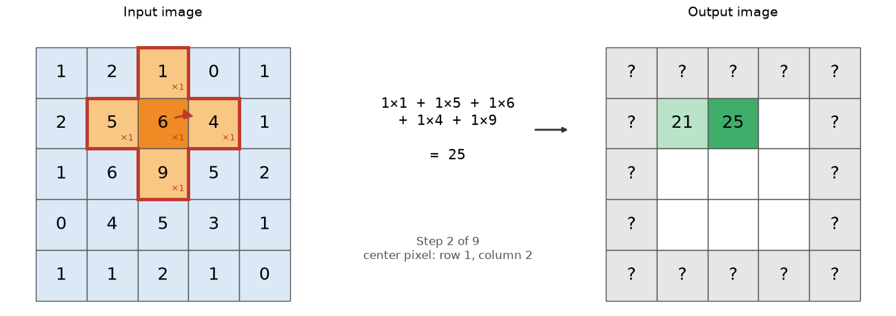
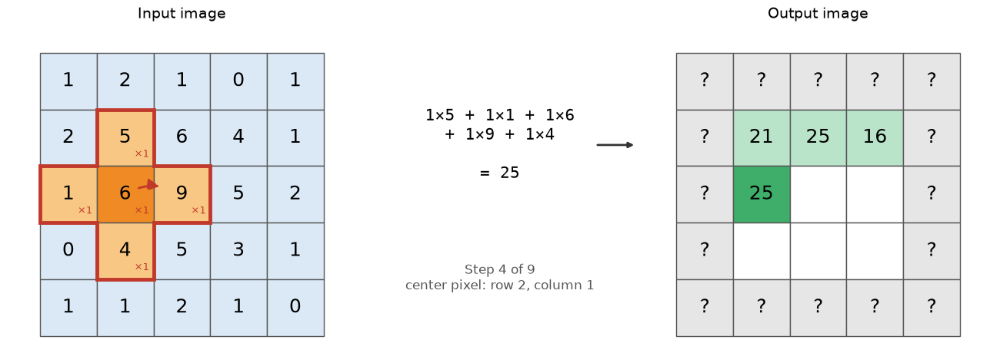
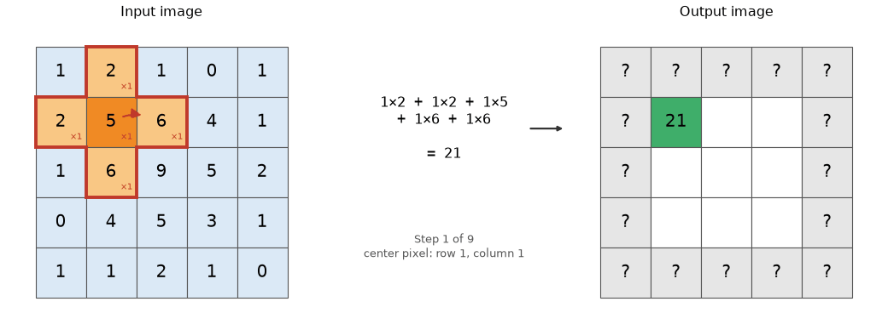

# Image filters and how they work

## Introduction
Image filters are used to reduce noise in the image, to sharpen borders, or to do things like blurring objects. They are still an important tool in the arsenal of possible image transformations that you can apply.  Image filters take an input image and produce an output image (even though your software may replace the input image on the screen with the output image). There are two fundamentally different forms: one where you can re-create the input image (given the output image and the filter), and one where that is not possible. In addition, there are filters that act globally on the whole image, and there are filters that act locally, and that are applied section by section on the whole image.  In this session, we will limit ourselves to these "local filters".

## Local filters, what is in the neighborhood?
Local filters use a "structuring element".  That "structuring element" will be laid over the pixel values (starting at the origin of the image), and the recipe defined by the structuring element will be applied to calculate a value for the central pixel under the structuring element in the output image. Then, the structuring element will move to the next pixel, the procedure will be repeated, etc.  Let's start with an example.

Below is a 5 x 5 image and a 3 x 3 structuring element that is missing its 4 corners, so it has the shape of a plus sign. A structuring element does not have to be square: only the pixels that are part of its shape take part in the calculation.  Each of those pixels has a weight (here all weights are 1, shown as "×1").

To calculate one output pixel:
1. Place the center of the structuring element (dark orange) on a pixel of the input image.
2. Multiply each input pixel under the structuring element (light orange) by its weight.
3. Add up the results.  The sum is the value of the output pixel at the position of the center pixel (dark green).

Then move the structuring element one pixel to the right (dashed arrow) and repeat.  The pixel values of the input image do not change; the results go into a new, output image.

At the end of a row, jump back to the start of the next row:

Continue until every pixel has been visited.  The animation shows all steps:

Notice that the pixels at the edge of the output image are marked "?".  When the center sits on an edge pixel, part of the structuring element falls outside the image, so there are no input values to multiply with.  Software has to make a choice here, for instance by pretending that the pixels outside the image are zero, or copies of the edge pixels.  Different choices give slightly different results at the image border.

* The pictures above were made with `uv run src/convolution_demo.py`.  Edit that script to change the weights in the structuring element (for instance, 4 in the center and -1 for the 4 neighbors) and run the script again.  What happens to the output values?  What do you need to change to calculate the average of the 5 pixels instead of the sum?

* Can you calculate the input image based on the output image and the structuring element (which often is called "kernel"?  If so, how would you do it?  

## Non-reversible filters: Median filter to reduce noise
A median filter will calculate the median of the pixels under the structuring element and place that value in the output image. Median filters are usually very good at removing "salt and pepper" noise (noise with a small portion of the pixels having outlier values).  Median filters will cause loss of some detail in the image.

* Open the image "testImages/Nucleus_cropped_noise.tif" in napari and inspect the image.  Ask your AI assistant to write a script that generates versions of this image with a median filter build from  a 3x3 kernel missing the corners, a 3x3 kernel, and a 5x5 kernel. Open these in napari and compare the effects of the different median filters. What happens to the noise, and what happens to the structure within the nucleus with these different filters?

## Smooth filter: A simple reversible filter to smooth and reduce noise.
A 3x3 filter with all weights at 1 will "smooth' the image.  This is the ImageJ/Fiji Smooth filter.  To preserve structure a little better, you can increase the weight of the central pixel of the kernel to a higher value (such as 4).

* Ask your coding asistant to write a Python script to apply the following kernels on your Nucleus_cropped_noise.tif:  a 3x3 kernel with all ones, a 3x3 kernel with all ones, except for the central pixel being 4, a 7x7 kernel with all ones. Normalize each kernel by its sum. Compare the output images with each other, and with the median filtered images.

## Sharpen filter: accentuate fine details
The kernel of the Sharpen filter in ImageJ looks as follows:
|       | Col 1  | Col 2  | Col 3 |
| ----- | ----- | ----- | ----- |
| Row 1 |  -1   |  -1   |  -1   |
| Row 2 |  -1   |  12   |  -1   |
| Row 3 |  -1   |  -1   |  -1   |

* Ask your AI assistant to use this Sharpen filter on the image "Actin_cropped.tif", and compare the result with it input.  What happened to the image, and what happen to the noise in the image? 

## Blurring the image with a Gaussian-shaped kernel and the unsharp mask
When you shape the kernel as a 2D Gaussian (bell shaped), it could end up looking something like:

|       | Col 1  | Col 2  | Col 3 |
| ----- | ----- | ----- | ----- |
| Row 1 |  1   |  2   |  1   |
| Row 2 |  2   |  4   |  2   |
| Row 3 |  1   |  2   |  1   |

It should now be easy to imagine a kernel that has a 2D Gaussian shape.  Interestingly, this is roughly the same shape as the Point Spread Function of your microscope. So, you could think about your microscope applying a 2D Gaussian blur on your real image.    

One fun application of a Gaussian blur is in the "unsharp mask"  Here, you first create a copy of the input image by applying a Gaussian blur, then substract the blurred image from the input image.  The size of the Gaussian kernel (size of the blur) is important,

* Ask your AI assistant to apply a Gaussian blue with a 5x5 gaussian kernel and a 21x21 Gaussian kernal on testImages/Actin_cropped.tif and save those images.  Also, subtract each from the input image to produce "unsharp masked" images.  Open these images in napari and describe the results. Look at the pixel values.  Are these still integer numbers?

* In a classical unsharp mask, a fraction of the "masked" image (as you calculated above) is added back to the original image.  Ask your AI assistant to implement that, and play with the amount to addk to the original for both unmasked (5x5 and 21x21) images.

## Edge finding filters (Sobel filters)
An "edge" is a place in the image where the intensity changes quickly, for instance at the border of a cell or along the side of an actin fiber.  To find edges, we look at the *difference* between neighboring pixels rather than at the pixel values themselves.  The simplest kernel that does this is one row of three pixels:

|       | Col 1  | Col 2  | Col 3 |
| ----- | ----- | ----- | ----- |
| Row 1 |  -1   |   0   |   1   |

The output is the pixel to the right minus the pixel to the left.  In a flat region the two cancel and the output is 0.  Where the image gets brighter from left to right, the output is positive; where it gets darker, it is negative.  Notice that the weights add up to 0: you can not "normalize" this kernel by its sum, and the output can have negative values.

The Sobel filter uses this same idea, but over three rows, with the middle row counting double.  This averages a little along the direction of the edge, which makes the filter less sensitive to noise.  There is one kernel for changes from left to right (it finds vertical edges), and one for changes from top to bottom (it finds horizontal edges):

Sobel x (left to right):
|       | Col 1  | Col 2  | Col 3 |
| ----- | ----- | ----- | ----- |
| Row 1 |  -1   |   0   |   1   |
| Row 2 |  -2   |   0   |   2   |
| Row 3 |  -1   |   0   |   1   |

Sobel y (top to bottom):
|       | Col 1  | Col 2  | Col 3 |
| ----- | ----- | ----- | ----- |
| Row 1 |  -1   |  -2   |  -1   |
| Row 2 |   0   |   0   |   0   |
| Row 3 |   1   |   2   |   1   |

To find edges in any direction, the two results are combined for each pixel as the square root of (Sobel x squared + Sobel y squared).  This "gradient magnitude" is always positive, and is what the "Find Edges" command in ImageJ/Fiji calculates.

* Ask your AI assistant to apply the Sobel x and Sobel y kernels to testImages/Actin_Cropped.tif, to combine the two results into the gradient magnitude, and to save all three images.  Open them in napari.  Which actin fibers stand out in the Sobel x image, and which in the Sobel y image?  Why?  What happens to the fibers in the gradient magnitude image: do you see one line or two lines per fiber?

* Edge filters look at differences between neighboring pixels, and noise also creates differences between neighboring pixels.  Ask your AI assistant to first blur Actin_Cropped.tif with the 5x5 Gaussian kernel from the previous section, and then calculate the gradient magnitude.  Compare with the result without blurring.  What happens to the noise, and to the edges?

* Another edge-finding kernel is the Laplacian, which compares a pixel with the sum of its 8 neighbors:

|       | Col 1  | Col 2  | Col 3 |
| ----- | ----- | ----- | ----- |
| Row 1 |  -1   |  -1   |  -1   |
| Row 2 |  -1   |   8   |  -1   |
| Row 3 |  -1   |  -1   |  -1   |

  Compare this kernel with the Sharpen kernel.  What do you need to add to the Laplacian to get the Sharpen kernel?  Ask your AI assistant to apply the Laplacian to Actin_Cropped.tif, and compare the result with your unsharp masked images.

* Is an edge-finding filter reversible?  Hint: what happens to the output if you add the same number to every pixel of the input image?

## Cross correlation
So far, the kernels were small, simple patterns of numbers.  But a kernel can be anything, including a small piece of an image.  When you slide a piece of an image over a larger image, multiply the overlapping pixels, and add up the results (exactly what we did with all the kernels above), the output is high where the image looks like the piece, and low where it does not.  This is called cross-correlation, and the piece of the image is called a "template".  Cross-correlation is used to find objects that look like a template, and to measure how far an image has moved, for instance to correct the drift of a sample during a time-lapse.

A note on names: in a "convolution", the kernel is flipped (top-bottom and left-right) before it is slid over the image; in a "cross-correlation", it is not.  For symmetric kernels, like the Smooth and Gaussian kernels, the two give the same result.  For a template cut from an image, they do not: to find a template, you need cross-correlation.

For these exercises we use the mitochondria channel of Cell_cropped.tif, saved as testImages/Mito_Cropped.tif (made with `uv run src/extract_mito.py`).  Away from the nucleus, it contains many small, separate, almost round mitochondria.  The file testImages/Mito_template.tif is an 11x11 pixel piece of Mito_Cropped.tif, cut out around one of these round mitochondria, below and to the right of the nucleus (rows 220 - 230, columns 167 - 177).  It was made with `uv run src/make_mito_template.py`.

* Open Mito_Cropped.tif and Mito_template.tif in napari and look at them.  Then ask your AI assistant to cross-correlate Mito_Cropped.tif with Mito_template.tif (without any normalization), to save the result, and to print where the highest value is.  Is that where the template was cut from?  Open the result in napari.  Where is the output high?  Does a high value really mean that the image looks like the template there?

* With simple cross-correlation, bright regions give high values whether or not they look like the template.  "Normalized" cross-correlation solves this by subtracting the average and dividing by the spread (standard deviation) of the pixel values, both for the template and for each piece of the image it is compared with.  The result is a number between -1 (the exact opposite of the template) and 1 (a perfect match).  Ask your AI assistant to calculate the normalized cross-correlation (for instance with `match_template` from scikit-image), to save the result, to find all peaks with a value above 0.8 that are at least 4 pixels apart, and to show these peaks as circles on top of Mito_Cropped.tif in napari.  How many did it find?  Where are they, and what do they look like?  Why are there no matches in the bright region around the nucleus?  What happens when you change 0.8 to a lower or higher value?

* Ask your AI assistant to make a copy of Mito_Cropped.tif that is shifted by a few pixels (for instance 7 pixels down and 4 pixels to the right), and to use cross-correlation of the original and the shifted image to find out how far it moved.  This is how drift in time-lapse movies can be measured and corrected.

