# Fourier Transform and noise

## What is a Fourier transform and why does it matter?

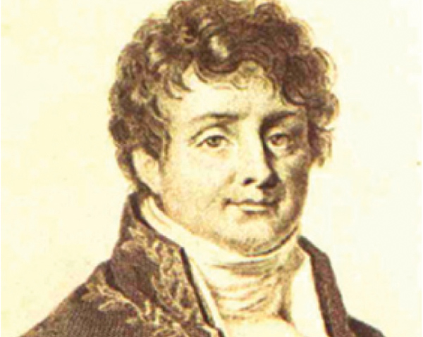

Jean-Baptiste Joseph Fourier was a French Mathematician/scientist who lived from 1768-1830.  While working on heat equations for solid metal objects he postulated that any (irregular) function or curve can be broken down and represented as an infinite sum of circles (sine and cosine waves). To illustrate the concept, we will build a square wave (a signal that jumps between +1 and -1, about as "un-wave-like" as a signal can be) from sine waves.  The animations below were made with `uv run src/fourier_series_demo.py`.

### Step 1: A sine wave is a point going around a circle
Imagine a point going around a circle at a steady speed.  If you only look at the height of the point and draw it against time, you get a sine wave.  That is why sine and cosine waves are called "circular functions".  Three numbers describe such a wave completely:

* **Frequency**: how many times per second the point goes around the circle.
* **Amplitude**: the radius of the circle, i.e. how high the wave goes.
* **Phase**: where on the circle the point starts at time 0 (the dotted lines), i.e. how far the wave is shifted in time.

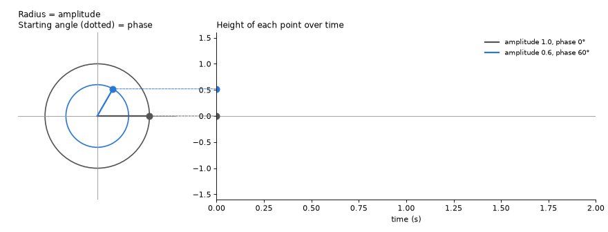

Both points go around once per second, so both waves have a frequency of 1 Hz.  The blue wave is smaller (amplitude 0.6 instead of 1.0), and it starts 60 degrees further along the circle (phase 60° instead of 0°), so it reaches its top earlier.

### Step 2: Adding sine waves gives a square wave
Here we will demonstrate how addition of multiple sine waves of different frequencies can mimic a square wave.  The animation starts with a single 1 Hz wave, and adds faster and smaller waves one at a time (3 Hz, 5 Hz, 7 Hz, ...).  The orange wave in the bottom panel is the wave that was just added.  On the right, every wave is shown as one stem at its frequency: its amplitude (top) and its phase (bottom).

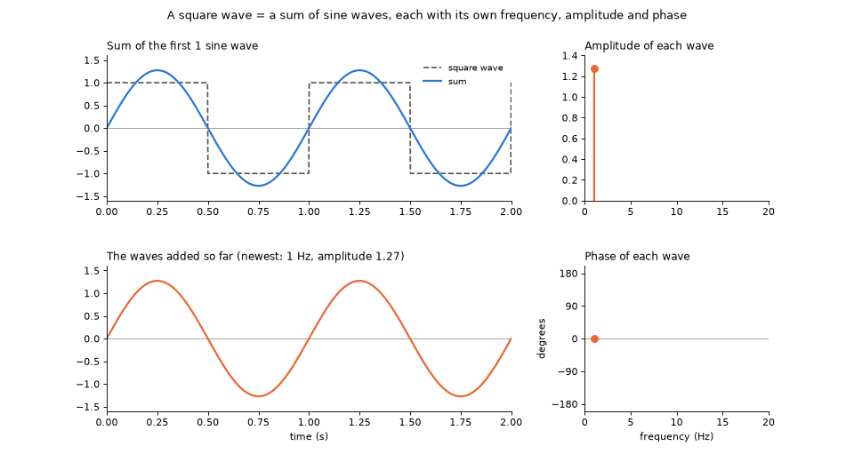

Notice that:
* The first wave alone already has the right "rhythm"; each next wave makes the corners sharper and the flat parts flatter.
* The fast waves are needed to make the sharp jumps.  Sharp edges in a signal (or an image!) are made of high frequencies.
* The two stem plots on the right are a complete recipe for the square wave: if you know the frequency, amplitude and phase of every wave, you can rebuild the signal.  **Calculating this recipe from a signal is exactly what a Fourier transform does.**  Rebuilding the signal from the recipe is called the inverse Fourier transform.

The recipe can also be drawn as a single picture: frequency from left to right, phase from bottom to top, and one spot for each sine wave, as bright as its amplitude.  All other positions are black (amplitude 0): the square wave contains no sine waves with those frequencies and phases.  For the square wave, all spots line up at a phase of 0 degrees, and they get dimmer at higher frequencies.  This picture was made with `uv run src/fourier_2d_spectrum.py`.

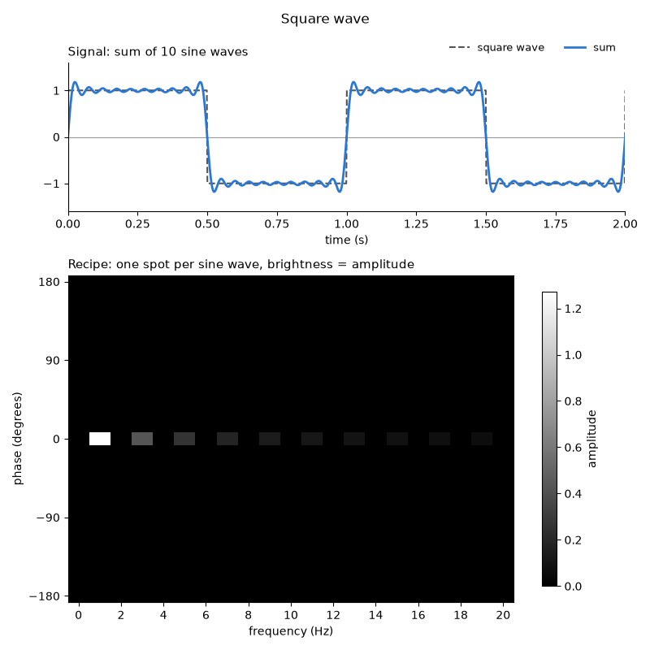

### Step 3: Circles riding on circles
Here are the same waves, now drawn as circles.  The center of each circle rides on the moving point of the previous (bigger, slower) circle.  The height of the last point (black) is the sum of all the waves.  This is quite literally Fourier's "sum of circles".  Using just 5 circles already comes close to a square wave.

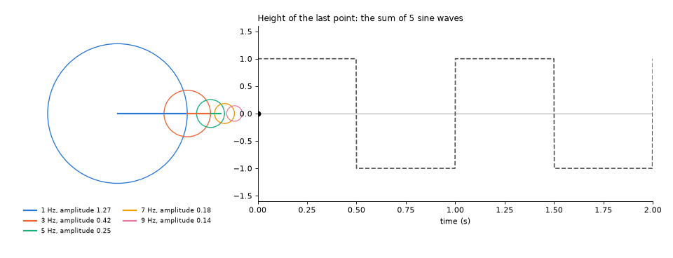

### Step 4: Amplitude alone is not enough, the phase matters
In this animation, the amplitudes of the 10 waves never change (look at the top right panel).  Only the phases change: they slowly move to random values, and back.  The waves are exactly the same size, but because they no longer start at the right moment, they no longer add up to a square wave.

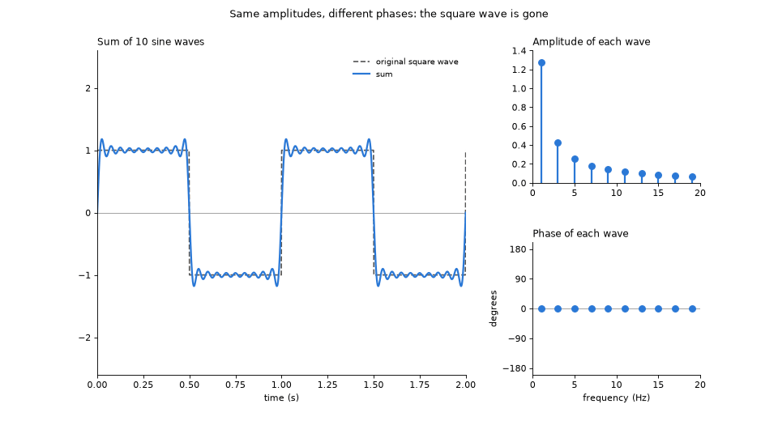

So, to describe a signal with sine waves, we need to know both the amplitude **and** the phase of each wave.  This is why the result of a Fourier transform is usually given as complex numbers: a complex number is a convenient way to store an amplitude and a phase together, as the length and the angle of an arrow (exactly the arrows on the circles in Step 1).

### Step 5: Moving the signal changes only the phases
Finally, the square wave slides a quarter of a second later in time.  The amplitudes do not change at all: the signal has the same shape, so it is made of the same "ingredients".  Only the phases change, and the faster waves change their phase more (they have to move the same distance in time, which is a larger part of their shorter cycle).

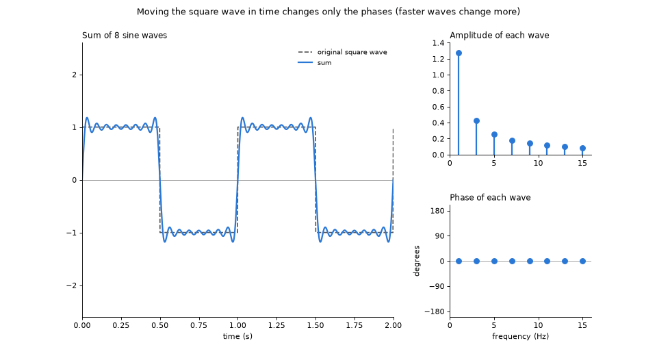

Here is the recipe of the moved square wave, drawn as a picture in the same way as in Step 2.  Compare it with the picture in Step 2: the spots have exactly the same brightness and sit at the same frequencies, but they moved up or down to a different phase.

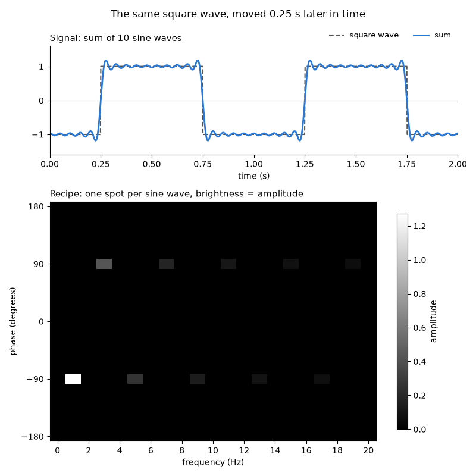

The amplitudes tell you *what* is in the signal; the phases tell you *where* it is.  We will see the same thing in images.

### Try it yourself
* Look at Step 2 again.  If you would leave out all waves faster than 5 Hz, what would the signal look like?  How does that compare to what a smoothing (blurring) filter from Session 3 does to an image?  This is the basis of using the Fourier transform to reduce noise.

* Ask your AI assistant to change `src/fourier_series_demo.py` so that the square wave is built from 50 instead of 10 waves, and run it again.  Do the small "overshoots" next to the jumps disappear, or do they only get narrower?

* A square wave only contains odd frequencies (1, 3, 5, ... Hz).  Ask your AI assistant to write a script that builds a "sawtooth" wave (a signal that rises steadily and then drops back at once) from sine waves, and to plot the amplitude and phase of each wave like in Step 2.  Which frequencies does a sawtooth need?

* In Step 5, the square wave was moved by a quarter of a second.  In the recipe picture, the 1 Hz wave moved to -90 degrees, but the 3 Hz wave moved to +90 degrees.  Can you explain why?  (Hint: what part of a full turn of its circle does a 3 Hz wave make in a quarter of a second, and what is -270 degrees on a circle?)

## The Discrete Fourier Transform of images
Everything above also works for images.  The only difference is that the waves are now two-dimensional.  A 2D wave looks like a pattern of stripes, and it is described by:

* **Frequency**: how close together the stripes are (how many stripes fit across the image).
* **Direction**: which way the stripes run.
* **Amplitude**: how much brighter the bright stripes are than the dark stripes.
* **Phase**: where the bright stripes are.

Any image can be built by adding up such stripe patterns, each with the right frequency, direction, amplitude and phase.  The pictures in this section were made with `uv run src/fourier_2d_images_demo.py`.

### Why "discrete"?
An image is not a smooth curve but a grid of pixels.  That limits which waves we need:

* The finest stripes an image can show are one pixel bright, one pixel dark: 2 pixels per stripe.  An image that is 64 pixels wide can therefore hold at most 32 stripes across.  Finer waves can not be represented by the pixels.
* Only waves that fit a whole number of times across the image are needed (0, 1, 2, 3, ... stripes across, in every direction).

So, an image has a limited ("discrete") list of possible waves, and the recipe is a list of numbers that has exactly as many entries as the image has pixels.  Calculating it is called the **Discrete Fourier Transform** (DFT).  The usual way to calculate it is a clever, very fast recipe called the **Fast Fourier Transform** (FFT), which is what Python's `numpy.fft.fft2` does.

### Reading a Fourier image
Because the recipe has as many numbers as the image has pixels, it is usually shown as an image of its own: the "Fourier image" (also called the "frequency space" image, as opposed to the "real space" image you started with).  Each pixel in the Fourier image is one 2D wave.  Like in Step 4, each pixel holds a complex number, so it has an amplitude and a phase.  Usually, only the amplitudes are shown, with brightness representing the amplitude.

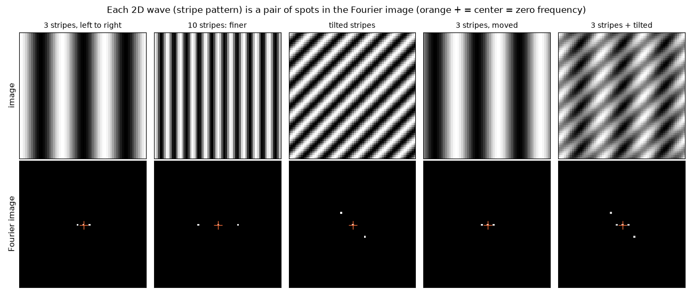

The top row shows simple images made of one or two stripe patterns, the bottom row their Fourier images (amplitudes only).  Notice that:

* **The center** of the Fourier image (orange +) is the wave with frequency 0: a wave that does not change at all.  Its amplitude is the average brightness of the image.
* **Each stripe pattern gives a pair of spots**, mirrored around the center.  For an image made of real numbers (as all of our microscopy images are), the Fourier image is always symmetric like this.  The mirrored spot does not carry new information.
* **Distance from the center = frequency.**  Finer stripes give spots further from the center (compare the first two examples).  The very edge of the Fourier image holds the finest stripes the pixels can show.
* **Direction from the center = direction of the change.**  The spots lie in the direction in which the brightness changes, which is perpendicular to the stripes themselves (look at the tilted stripes).
* **Moving the stripes does not change the amplitudes** (compare "3 stripes" and "3 stripes, moved").  Like in Step 5, only the phases change.
* **Adding images adds their Fourier images** (last example).

### The Fourier image of a cell
Here is the actin image from Session 3, with the amplitudes (middle) and the phases (right) of its Fourier image.

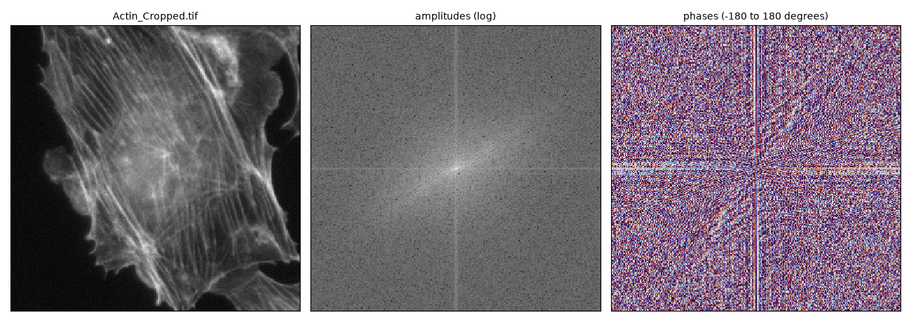

The amplitudes range from very large (in the center) to very small (at the edges), so they are shown on a logarithmic scale; otherwise only the bright center would be visible.  Notice that:

* Most of the amplitude is near the center: most of an image is made of slow changes (large areas of similar brightness).  Fine details and noise are made of the weak waves further out.
* The bright streak through the center runs from bottom left to top right: perpendicular to the stress fibers, which mostly run from top left to bottom right.  The Fourier image tells you the main direction of structures in the image.
* The thin horizontal and vertical lines through the center have nothing to do with the cell.  The DFT treats an image as if it repeats forever, like tiles on a floor.  The left edge of the actin image is dark and the right edge is bright, so where two tiles meet, there is a sharp jump, which needs waves in the left-right direction.  The same is true for the top and bottom edges.
* The phases look like random noise.  But as we will see below, they hold most of the information about where things are.

### Building an image from its waves
Just like the square wave in Step 2, we can rebuild the actin image from its waves.  Here, the waves are added in order of their amplitude, the strongest first.  The left panel shows which waves are used (they are in the Fourier image), the middle panel the image built from only these waves.

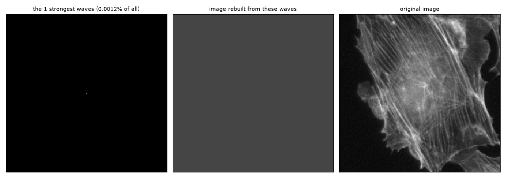

With only 1% of the waves (the strongest ones, all near the center), the cell is already clearly recognizable, but it is blurry.  The many weak waves far from the center are needed for the sharp details, and for the noise.

### Amplitude or phase: which matters more?
To see how important the phases are, we can mix two images: take the amplitudes from the Fourier image of one, and the phases from the Fourier image of the other, and transform back.

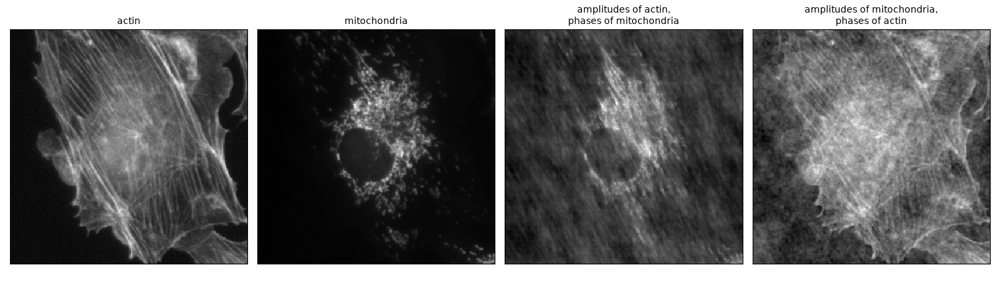

The result looks like the image that donated the phases, not like the image that donated the amplitudes.  The amplitudes do leave a trace: notice the diagonal streaks (the main direction of the actin fibers) in the third image.  But the phases determine *where* everything is, and that is what we recognize.

### Try it yourself
* Ask your AI assistant to write a script that calculates the Fourier image of testImages/Mito_Cropped.tif, and shows the image and the logarithm of the amplitudes of its Fourier image side by side in napari.  Compare it with the Fourier image of the actin image.  Is there a main direction?  Why (not)?

* Ask your AI assistant to rotate the actin image by 45 degrees (for instance with `scipy.ndimage.rotate`) and to show the Fourier images of the original and the rotated image.  What happens to the Fourier image?

* Ask your AI assistant to make a 64 x 64 pixel image with 30 vertical stripes, and one with 40 vertical stripes, and to show both images and their Fourier images.  How many stripes do you count in the second image?  Where is its spot in the Fourier image?  What does this tell you about trying to image structures that are finer than your pixels can show?

## Filter images in Fourier space

### Convolution in real space is multiplication in Fourier space
In Session 3, we filtered images by convolution: sliding a kernel over the image, and for every pixel multiplying and adding the pixel values under the kernel.  There is a second way to get exactly the same result:

1. Calculate the Fourier image of the image.
2. Calculate the Fourier image of the kernel (the kernel is first placed in an image of zeros, the same size as the image).
3. Multiply the two Fourier images, pixel by pixel.
4. Transform the result back.

This is called the **convolution theorem**: convolution in real space is the same as multiplication in Fourier space.  Why would that be?  Remember that an image is a sum of waves (stripe patterns).  When you smooth a stripe pattern, you still get the same stripe pattern, only with less contrast (and perhaps slightly moved).  So, a convolution does not mix waves: it only changes the amplitude (and phase) of each wave on its own.  How much each wave changes is exactly what the Fourier image of the kernel tells you.  When two complex numbers are multiplied, their amplitudes multiply and their phases add up.

Here is the noisy nucleus image from Session 3 (testImages/Nucleus_cropped_noise.tif), smoothed with the 3x3 Smooth kernel (all ones, divided by 9).  The top row shows the convolution in real space, the bottom row the same calculation in Fourier space.  This picture was made with `uv run src/fourier_convolution_demo.py`.  The script smooths the image in both ways, and prints the largest difference between the two results: 0.000000000003, which is only the rounding of the computer's arithmetic.

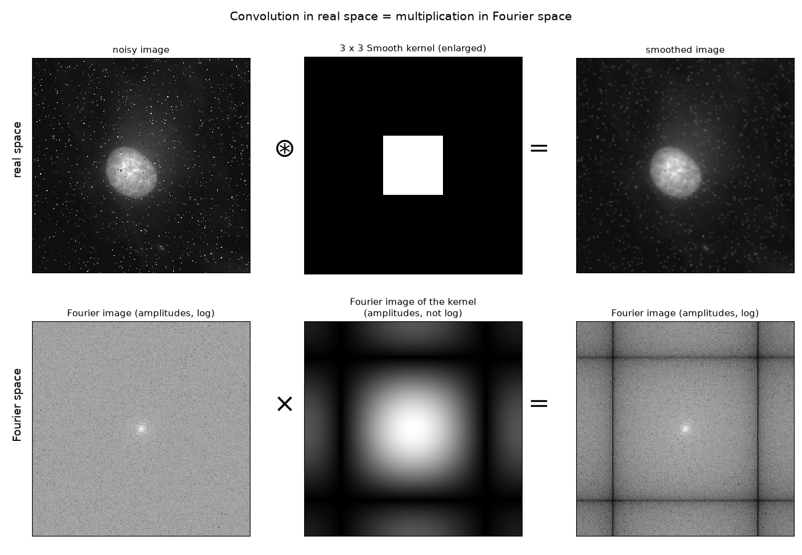

Notice that:

* **The noise is everywhere in the Fourier image of the noisy image.**  The nucleus gives the bright spot in the center (large, slowly changing structures).  The noise gives the bright, even "floor" that fills the whole Fourier image.  A single bright pixel is the sharpest possible feature, and it needs waves of all frequencies, in all directions, with equal amplitude.  Hundreds of noisy pixels spread their energy over the whole Fourier image.
* **The Fourier image of the kernel is 1 in the center, and becomes smaller further out.**  It keeps the slow waves, and weakens the fast waves: a "low-pass filter".  The center is exactly 1 because we divided the kernel by the sum of its weights, so the average brightness of the image does not change.
* **The dark lines are waves that the Smooth kernel removes completely.**  These are stripes that repeat every 3 pixels: the average of 3 neighboring pixels of such a stripe pattern is always the same, so the stripes disappear.
* **Beyond the dark lines, the Fourier image of the kernel gets brighter again** (up to 1/3 at the edges and 1/9 in the corners).  The Smooth kernel does not remove the finest waves completely.  This is why each noise pixel becomes a small, faint square in the smoothed image instead of disappearing.
* **The Fourier image of the smoothed image is the product of the other two.**  You can see the dark lines of the kernel in it.  Because the amplitudes are shown on a logarithmic scale, the rest of the outer region looks only a little darker, but the amplitudes there are 2 to 9 times smaller than in the noisy image.

A note on the edges: the convolution theorem treats the image as if it repeats like tiles on a floor (see "The Fourier image of a cell" above).  To get exactly the same result with convolution, the convolution must do the same at the edges of the image (in Python: `scipy.ndimage.convolve(..., mode="wrap")`).  Other ways of handling the edges only change the pixels at the very border of the image.

Why is this useful?
* **Speed.**  For a large kernel, convolution needs many multiplications for every pixel (a 21x21 kernel needs 441), while in Fourier space it is one multiplication per pixel, plus the (fast!) Fourier transforms.
* **Design your own filter.**  Instead of choosing a kernel, you can directly choose which waves to keep and which to remove, by multiplying the Fourier image with a "mask" of your choice.  That is what we will do to reduce noise.
* **Understanding your microscope.**  A microscope blurs the sample with its Point Spread Function (see Session 3): a convolution.  The Fourier image of the Point Spread Function (called the Optical Transfer Function) is zero beyond a certain frequency.  Those waves, the finest details of the sample, never make it into your image: this is the resolution limit of your microscope.

### Try it yourself
* Ask your AI assistant to change `src/fourier_convolution_demo.py` to use the 7x7 Smooth kernel (all ones, divided by 49).  Where are the dark lines in the Fourier image of the kernel now?  What does that mean for the smoothed image?

* Ask your AI assistant to make the same picture with the 5x5 Gaussian kernel from Session 3.  How does the Fourier image of a Gaussian kernel look?  Does it have dark lines?  Is the noise in the smoothed image still turned into small squares?

* Ask your AI assistant to make the same picture with the Sharpen kernel from Session 3 (normalized by its sum).  What does the Fourier image of this kernel do to the slow and to the fast waves?  What happens to the noise?

* In Session 3 you were asked whether you can calculate the input image from the output image and the kernel.  In Fourier space, that looks easy: divide the Fourier image of the smoothed image by the Fourier image of the kernel, and transform back.  Ask your AI assistant to try this with the 3x3 Smooth kernel.  What happens, and why?  (Hint: look at the dark lines in the Fourier image of the kernel.)

### Low-pass and high-pass filters
Instead of starting with a kernel, we can now design a filter directly in Fourier space: decide which waves to keep, and which to remove.  We do this by multiplying the Fourier image with a "mask": 1 for the waves we keep, 0 for the waves we remove.

* A **low-pass filter** keeps the slow waves (in the center of the Fourier image) and removes the fast waves.  The script `src/fourier_lowpass_nucleus.py` does this for the noisy nucleus image: it calculates the Fourier image, blacks out everything outside a circle with a diameter of 10% of the image, and transforms back.  Only 633 of the 81,792 waves (less than 1%) are kept.  Run it with `uv run src/fourier_lowpass_nucleus.py` and open the results in napari.
* A **high-pass filter** does the opposite: it blacks out the center, and keeps everything else.  What remains are the fine details (and the noise).  Because the center (the average brightness) is removed as well, the pixel values of the result are around 0, both positive and negative.  High-pass filters are used to make fine structures and edges stand out, and to remove slow changes in brightness, such as uneven illumination.

The low-pass and the high-pass filter with the same circle split the image into two parts: adding the two results gives back the original image.

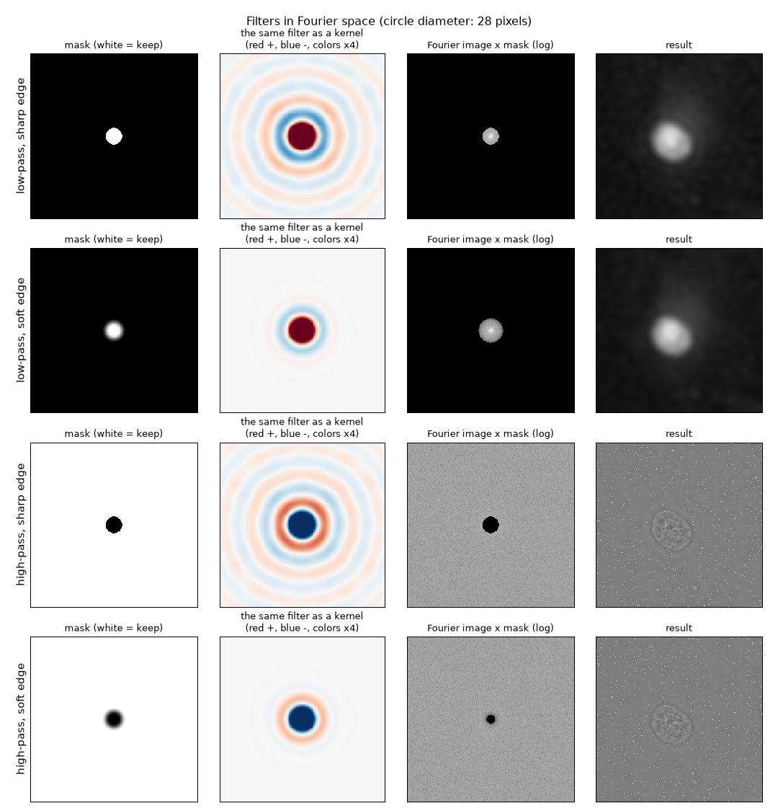

Each row of this picture is one filter (made with `uv run src/fourier_filters_demo.py`).  From left to right: the mask, the kernel that does the same in real space (the inverse Fourier transform of the mask, see the convolution theorem above), the Fourier image multiplied by the mask, and the result.  Look at the first and third rows (the sharp-edged masks) for now:

* The low-pass filter removes the noise completely, but also the texture inside the nucleus: that texture is made of the same fast waves as the noise.
* The high-pass filter keeps the noise, and the edges and the texture of the nucleus.  The large, smooth areas (the bright nucleus, the dark background) are gone.

### Ringing, and how to avoid it
Look at the kernels of the sharp-edged masks (first and third rows, second column): they are surrounded by rings, alternating positive (red) and negative (blue).  Every bright pixel and every edge in the image gets a copy of these rings.  The result is ripples next to edges, called **ringing**.  It is the same thing as the "overshoots" next to the jumps of the square wave in Step 2: when you build a sharp edge from a limited set of waves and stop abruptly at some frequency, the waves no longer cancel each other completely next to the edge.

The cure is to make the edge of the mask soft: instead of jumping from 1 to 0, the mask goes from 1 to 0 smoothly (here shaped as half a cosine wave).  This is called **apodization**.  The kernels of the soft-edged masks (second and fourth rows) have hardly any rings left.

The ringing is easiest to see with a test image that has a perfectly sharp edge:

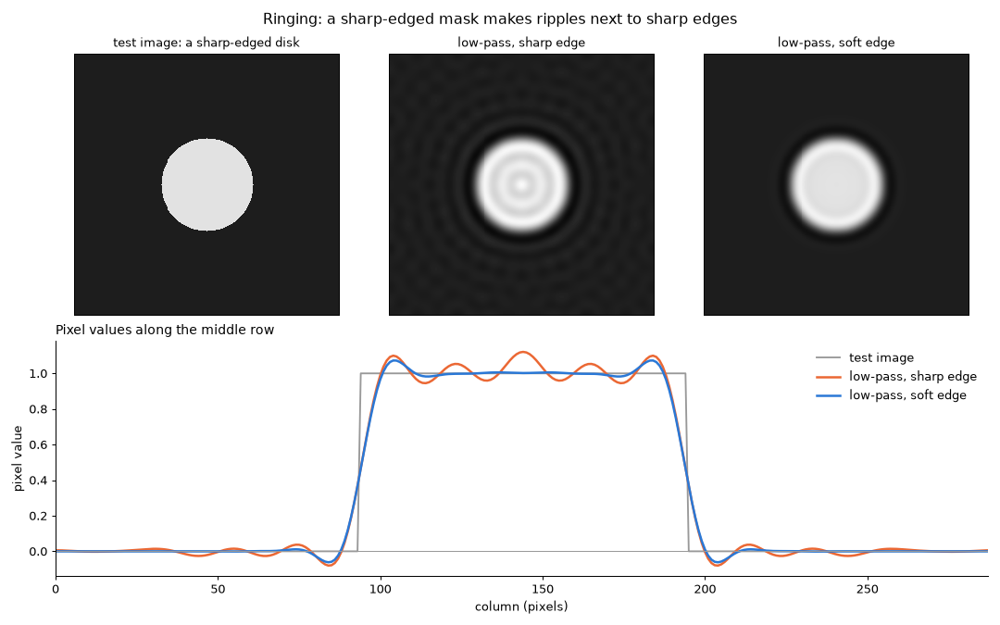

With the sharp-edged mask, the disk is surrounded by rings, and there are ripples inside it.  With the soft-edged mask, the repeating ripples are gone: only one small overshoot just inside the edge and one small dip just outside it remain.  The price is that a soft edge does not separate "keep" from "remove" as strictly as a sharp edge: some slightly faster waves are let through, and some slightly slower waves are weakened.

In real microscope images, edges are never perfectly sharp: the microscope has already blurred them (see "Understanding your microscope" above).  So, the ringing in the nucleus image is much smaller, but you can still see it along a line through the nucleus.  The sharp-edged mask gives a higher peak, and small extra wiggles next to the nucleus (around columns 75 and 180):

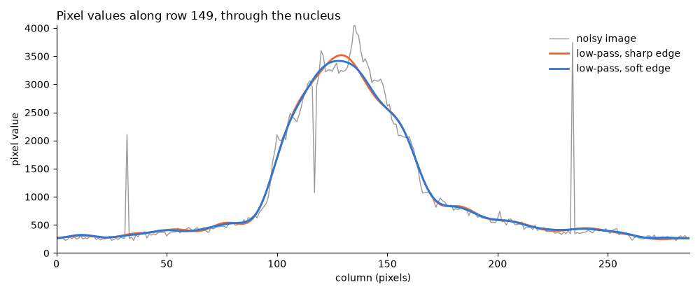

### Try it yourself
* Change `DIAMETER_FRACTION` at the top of `src/fourier_lowpass_nucleus.py` to 0.05, 0.2 and 0.4, and run it each time.  Open the results in napari.  What happens to the noise, and to the texture inside the nucleus?  Which diameter would you choose?

* Ask your AI assistant to change `src/fourier_lowpass_nucleus.py` so that it uses a Gaussian-shaped mask (bright in the center, smoothly fading out, like a 2D bell curve) instead of a circle.  What kernel does a Gaussian mask correspond to?  Compare the result with the Gaussian-blurred images from Session 3.

* Compare the low-pass filtered nucleus with the median-filtered images from Session 3.  Which works better for this kind of "salt and pepper" noise?  Why can no mask in Fourier space separate the noise from the texture of the nucleus?  (Hint: look at where the noise is in the Fourier image of the noisy image.)

* Ask your AI assistant to apply a soft-edged high-pass filter to testImages/Actin_Cropped.tif, and to save the result.  Open it in napari, next to the original.  What happens to the stress fibers, and to the brightness differences between the inside and the outside of the cell?  Compare the result with the "unsharp masked" images from Session 3.

## What is noise actually?
Even though we have already played with several de-noising methods, we have not really defined what noise is.  From an image processing point of view there are 2 main sources of noise:
- Detector noise, for instance, an image taken without any light reaching the camera (the dark image) will show variations in pixel intensity.  Taking multiple such images can show that the intensities in invidual pixels are varying as well.  Your camera has an "offset" and pixels show a variation around this offset.  In addition, when light reaches the sensor, not all pixels may respond equally (or even linearly).  
- Photon shot noise.  Almost all light sources emit photons irregularly (similar to radioactive decay, a Geiger counter ticks irregularly). The variation around the mean is called "Photon Shot Noise" and scales with the square root of the signal.  So, even if there is no other source of noise (unlikely), your signal/noise ratio will never be higher than the square root of the signal.  Therefore, always try to maximize the signal.
Nevertheless, you will encounter lots of signal in your images that you consider noise.  For instance, room light may leak through inr your images, some fluorescence excitation light leaking through filters may cause a background, your cells may exhibit unwanted auto-fluorescence, your antibody staining may cause unwanted background, etc..  These types of noise are signal from an image analysis point of view, but clearly unwanted, and noise from your point of view.  Reducing them at the source is a great start, but you will surely look for image analysis tricks to reduce their influence in your quantification as well.

## Other Denoising methods
So far, we have discussed filters based on convolution, and fourier domain filters and their usefulness to reduce noise in images (thereby increasing signal-noise ratio, which should help with downstream analysis).  During the last few years, deep learning-based methods have been developed to reduce noise in biological images.  These can be supervised (a model learns from noise input images, combined with "clean" denoised images as the ground truth), or unsupervised as in the Noise2Void algorithm (https://imagej.net/plugins/n2v).  Loic Royer and his group at the Biohub developed a software package that let's you explore differen denoising methods, which they called ["Aydin"](https://github.com/royerlab/aydin).  Regretfully, Aydin does not play nice with our Python environment.  I created a brand new environment (tested on Mac and Windows) that will run Adyin.  You can test this by:
- Cloning the repository: 'git clone https://github.com/nicost/aydin_test.git'
- 'cd aydin_test'
- 'uv run aydin'

