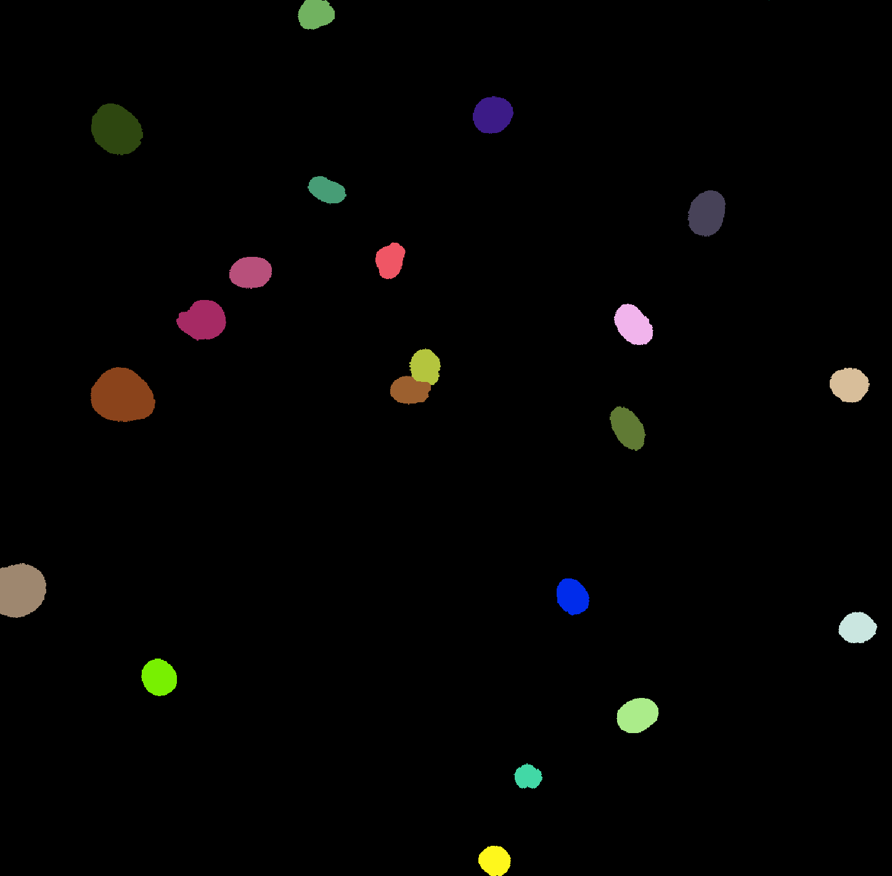

# Segmentation

## Defining objects through segmentation
Segmentation in image analysis literally means segmenting the image in two or more objects.  These objects are defined by their numerical value in the image.  The simplest way to segment an image is to set a threshold, set everything below or at the threshold to zero (this could represent the background in the image) and everything above the threshold to 1 (this could be the object(s) that you are interested in).  

* Open napari ('uv run napari').  Open the file 'testImages/3Channel_FF_Corrected_1/3Channel_FF_Corrected_1_MMStack_Pos0.ome.tif' (use the "napari-tiff" opener, you may need to choose "File > Open with plugin" to get that option).  If the image stays black, choose a colormap for each channel (for example, magenta, green, blue). Only consider the "DAPI" channel (you can click the eye for the other channels to make them invisible). Inspect the pixel values inside and outside of the nuclei.  Where would you set the threshold, so that nuclei will have a higher value than the threshold, and the background will not?  Ask your AI assistant to segment the DAPI channel of this image with your threshold, and view the resulting segmented image in napari.  What problem(s) do you (and/or your AI assistant) note?

Setting a threshold by eyeballing does not scale well, and certainly is not reproducible (poll your neighbors about the threshold they choose).  Ask your AI assistant what methods exist in scikit-image to automatically determine a threshold and how they work.

### What is an object?  Connected pixels
To go from a segmented image to objects, the computer code needs to determine which pixels are connected.  This works with a structuring element very much like the kernels that we used for convolution filters.  This structuring element often is a 3x3 element, or a 3x3 element with no corners (i.e. a plus sign).  The code places the center of the structuring element (X in the tables below) on each foreground pixel (value one).  That pixel belongs to the same object as every other foreground pixel under the structuring element: one such neighbor is enough.  Repeating this from pixel to pixel, an object is everything you can reach by stepping between neighboring foreground pixels.  Note that scikit-image uses the full 8 neighbors by default, while SciPy (`scipy.ndimage.label`) uses the plus sign.  This can make a big difference: pixels that only touch at their corners are one object with 8 neighbors, but separate objects with the plus sign.

Plus sign structuring element
|       | Col 1  | Col 2  | Col 3 |
| ----- | ----- | ----- | ----- |
| Row 1 |     |  1   |     |
| Row 2 |  1   |  X   |  1   |
| Row 3 |     |  1   |     |

Full 8 connected neighbors
|       | Col 1  | Col 2  | Col 3 |
| ----- | ----- | ----- | ----- |
| Row 1 |  1   |  1   |  1   |
| Row 2 |  1   |  X   |  1   |
| Row 3 |  1   |  1   |  1   |

* Ask your AI coding assistant to write a script that reads the DAPI channel in testImages/3Channel_FF_Corrected_1/3Channel_FF_Corrected_1_MMStack_Pos0.ome.tif, thresholds it with a value determined with the Otsu method, and counts the total number of objects (independent of size). Show a histogram of the size (in number of pixels) of the objects.

You likely noted a significant number of very small objects (for instance, 11).  You can filter these out based on their size (this is a very fair way of dealing with objects, you often have a good idea of the possible size range and can use that information to hone in on what is interesting).  However, you can also remove these through a process called "erosion".  When "eroding" a segmented image, the structuring element is moved over the image.  When all pixels in the element are "true" (value of one) in the input image, the output pixel will be set to one, when any of the pixels under the element are false, the output pixel will be set to zero.  This leads to the disappearance of isolated pixels, and the erosion of pixels at the borders of objects.  To compensate for this loss of pixels at the borders, erosion is often followed by "dilation".  During dilation, the output pixel is set to true if any of the pixels under the structuring element are true.  You can have multiple rounds of erosion followed by an equivalent number of rounds of dilation. Erosion followed by dilation is often called "opening". 

* Ask your AI assistant to run two rounds of erosion followed by two rounds of dilation on the DAPI channel in  testImages/3Channel_FF_Corrected_1/3Channel_FF_Corrected_1_MMStack_Pos0.ome.tif after Otsu thresholding and create a histogram of the  size of the remaining objects.  

If the goal is to fill holes within existing objects, you can change the order: first run dilations until the holes are filled, then run erosions (which will not re-open the holes) to compensate for the effect on the size of the object. This called "closing". 

### From segmented images to objects
You now have a segmented, binary (only zeros and ones) image on which you clearly can see what is nucleus and what is not.  For the computer to recognize these as individual entities, it is much nicer to give each connected area its own number and use a LookUp Table that has different colors for these numbers.  

* Ask your AI coding assistant to open the DAPI channel from testImages/3Channel_FF_Corrected_1/3Channel_FF_Corrected_1_MMStack_Pos0.ome.tif, threshold it using the Otsu method, run 3 rounds of erosion and 3 rounds of dilation on it, and label each of the objects with a distinct number, and save the image with a LUT with distinct colors for these numbers. Note, to see the labels as distinct colors in napari, you may need to right-click the layer and choose "Convert to Labels".  

You may have noticed that nuclei that are close together in the image are not separated.  The watershed algorithm was designed for such problems.  Think of the image as a landscape, in which the pixel values are heights:

1. The algorithm first calculates, for each pixel in the segmented image, its distance to the background.  The center of each nucleus becomes (hopefully) a peak, and where two nuclei touch, there is a narrow, lower "waist".
2. It takes the negative of this distance image, which turns the landscape upside down: each nucleus is now a valley, and the waist between two touching nuclei is a ridge.
3. It places one "seed" at the bottom of each valley.  Finding these seeds is the critical step: they are usually the local peaks of the distance image, at least a minimum distance apart (often called `min_distance`).  Too few seeds, and touching nuclei stay joined; too many, and a single nucleus is cut into pieces.
4. Water rises from each seed and floods its valley.  Where the water from two seeds meets (on the ridge), a border is drawn.  The segmented image limits where the water can go, so the background stays background.

The result is a label image in which touching nuclei are (hopefully) separated.

* Ask your AI coding assistant to open the DAPI channel from testImages/3Channel_FF_Corrected_1/3Channel_FF_Corrected_1_MMStack_Pos0.ome.tif, threshold it using the Otsu method, run 3 rounds of erosion and 3 rounds of dilation on it, and run the watershed algorithm to produce a labeled image. Open it in napari (to see the labels as distinct colors in napari, you may need to right-click the layer and choose "Convert to Labels").  

You also likely noticed that there are several nuclei cut off by the borders of the image.  These will obviously give incorrect results for values such as the size of the nucleus.  

* Ask your AI coding assistant to repeat the step above, but now exclude objects touching the borders of the image.

> Note: it is very insightful to read the Python scripts that your AI assistant generates.

## From objects to numbers to insights
You now have seen how one can go from an image of nuclei to an image with numbered masks - corresponding to the nuclei and a few other things.  At this point, there is a lot that you can quantify:
- How many nuclei are there (note, you will need to specify a size cut-off to avoid counting small objects and you sometimes may want to exclude nuclei that were not separated by the watershed, but be careful of over-exclusion)
- How round are the nuclei (ratio of long and short axes)
- What is the area of the nuclei (in square microns)?
- What is the sum of the pixel values in the original image under the mask?
- What is the average pixel value per nucleus in the original image under the mask?
- What is the standard deviation of the pixel values in the original image under the mask (per nucleus)?
- etc....

> * Ask your AI coding assistant to write a script to calculate these things

* If metaphase cells were present, how could you detect these in the output of the values you just received?

* If you would like to quantify DNA content (for instance to detect G1 versus G2 cells), which parameter would you choose?  Do you need to correct that parameter for something that you can measure?  Ask your AI coding assistant to generate a histogram of that parameter (after correction).

## Please commit code and output that you find useful to your own branch

